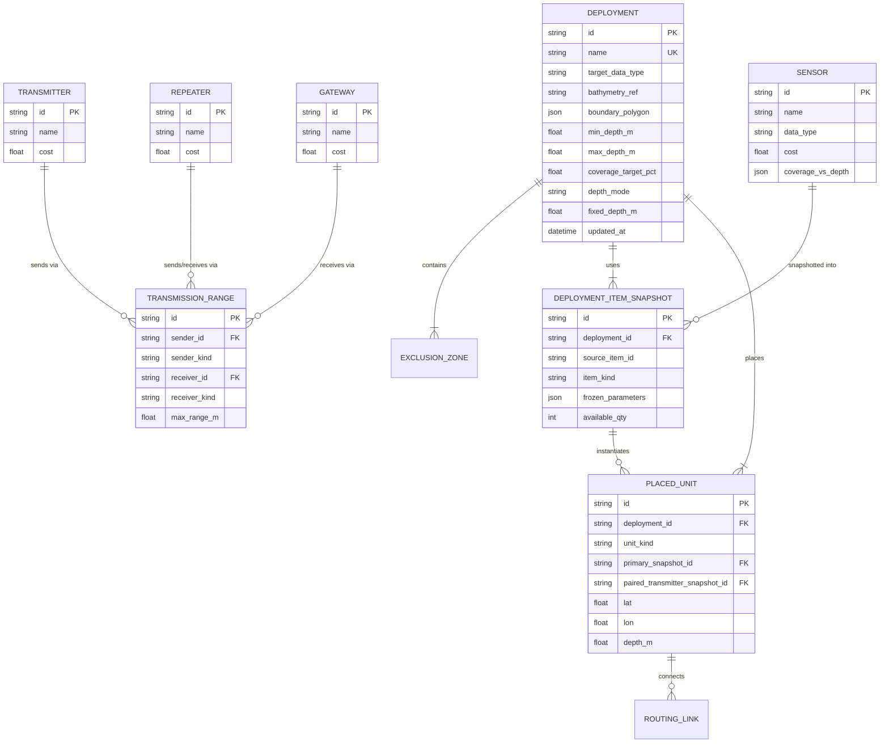
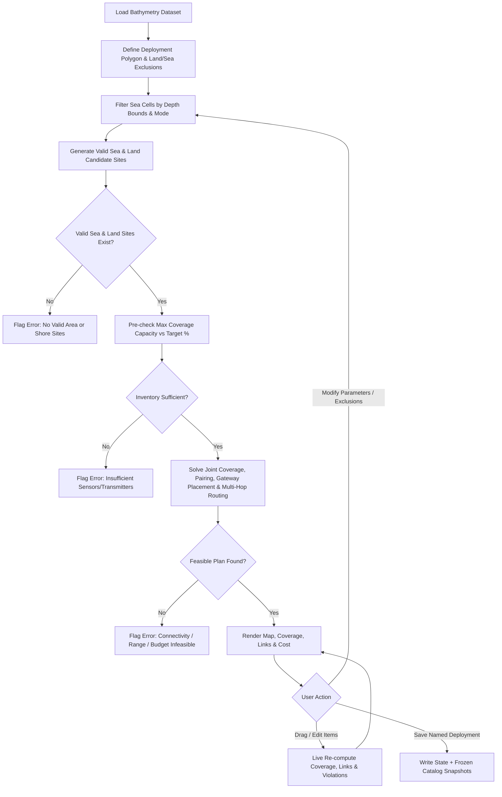

# Software Specification: Sea Sensor Deployment Planner (v1.0)

> [!NOTE]
> This specification incorporates **Requirements 1** together with confirmed stakeholder design decisions. It serves as the baseline v1.0 blueprint for implementation.

---

## 1. Purpose & Scope

The **Sea Sensor Deployment Planner** is a **desktop application** for planning cost-optimal marine sensor deployments. Given a target maritime region, bathymetric dataset, land/sea exclusion zones, available hardware inventory, and a target coverage percentage, the application calculates optimal placements for sensors (each paired 1-to-1 with a transmitter), floating repeaters, and land-based gateways so that:

1. At least the specified **percentage** of the valid sea area is covered by sensors measuring the selected data type.
2. Every deployed sensor/transmitter has a viable communication path (direct or multi-hop via floating repeaters, with no fixed hop limit) to an optimizer-placed land gateway.
3. Total deployment cost is minimized while respecting all spatial, depth, and inventory constraints.

### Phased Roadmap
* **Version 1 (Initial Desktop Release):**
  * User selects available hardware types and quantities from the database.
  * Each deployment plans coverage for **one selected sensor data type**.
  * Optimizer determines placements for sensors (+ paired transmitters), floating repeaters, and shore gateways.
* **Version 2 (Future Enhancements):**
  * Optimizer automatically selects item types and quantities directly from the master database without manual inventory caps.
  * Support for simultaneous multi-data-type coverage within a single deployment plan.

---

## 2. Confirmed Design Decisions

| Topic | Confirmed Decision | Specification Impact |
| :--- | :--- | :--- |
| **Sensor–Transmitter Pairing** | **1:1 pairing** (each deployed sensor has a single transmitter) | Each placed sea sensor unit pairs one Sensor with one Transmitter; total placed transmitters equals total placed sensors. |
| **Gateway Placement** | **Optimizer-placed** | Gateways are placed by the optimizer on valid **land** locations (outside land exclusion zones) to minimize total cost while maintaining connectivity. |
| **Bathymetry Input** | **Bathymetric datasets** | Application imports standard bathymetric data (e.g., GeoTIFF, NetCDF/GEBCO, XYZ/CSV grids) to determine land/sea masks and water depths. |
| **Coverage Metric** | **Percentage (%)** | User specifies a target percentage (e.g., `85%`) of the valid sea deployment area that must fall within sensor coverage footprints. |
| **Data Types (v1)** | **Single data type per deployment** | User chooses one target measurement type per v1 plan; sensor selection filters to matching items. |
| **Multi-Hop Routing** | **No maximum hop limit** | Repeaters may chain across any number of cycle-free hops to reach a gateway, limited only by pairwise ranges and available repeater inventory. |
| **Target Platform** | **Desktop application** | Native/local desktop GUI with local database persistence and local optimization solver execution. |

---

## 3. Domain Entities & Data Model

### 3.1 Core Entities

| Entity | Role | Location Constraint | Key Properties |
| :--- | :--- | :--- | :--- |
| **Sensor** | Captures a specific type of marine measurement | At sea only (outside sea exclusions, within `[min_depth, max_depth]`); paired 1:1 with a Transmitter | `id`, `name`, `data_type`, `cost`, `coverage_vs_depth` (radius/area vs. depth curve or table) |
| **Transmitter** | Transmits data from its paired Sensor to a Gateway or Repeater | Co-located with its paired Sensor at sea | `id`, `name`, `cost` |
| **Repeater** | Floating relay receiving data from Transmitters or other Repeaters and forwarding toward Gateways | At sea only (floating; outside sea exclusions, within valid depth bounds) | `id`, `name`, `cost` |
| **Gateway** | Shore station receiving data from Transmitters and Repeaters | **On land only** (outside land exclusions); coordinates chosen by optimizer | `id`, `name`, `cost` |
| **Transmission Range** | Pairwise communication range between sender and receiver | N/A (Catalog relationship) | `sender_id`, `sender_kind` (`Transmitter`/`Repeater`), `receiver_id`, `receiver_kind` (`Repeater`/`Gateway`), `max_range_m` |

### 3.2 Entity-Relationship Diagram

> [!IMPORTANT]
> **Snapshot Isolation:** Saving a deployment creates immutable records in `DEPLOYMENT_ITEM_SNAPSHOT` capturing the exact `cost`, `coverage_vs_depth`, and `TRANSMISSION_RANGE` matrix values used at that time. Future edits to the master hardware catalog never alter previously saved deployments.

---

## 4. Functional Requirements

### 4.1 Hardware & Range Database Management (`FR-DB`)
* **FR-DB-1:** The desktop application shall store persistent local catalogs for **Sensors**, **Transmitters**, **Repeaters**, **Gateways**, and **Pairwise Transmission Ranges**.
* **FR-DB-2:** Users shall be able to create, view, edit, and delete items in each catalog.
* **FR-DB-3:** Each **Sensor** shall specify its measurement `data_type`, unit `cost`, and a depth-dependent coverage function (supporting constant radius, lookup table with linear interpolation, or formula).
* **FR-DB-4:** Transmission range shall be defined per `(Sender, Receiver)` pair (`Transmitter -> Gateway`, `Transmitter -> Repeater`, `Repeater -> Repeater`, `Repeater -> Gateway`). Unlisted pairs are treated as incompatible (no link possible).
* **FR-DB-5:** Validation shall prevent deleting or breaking referential integrity of active catalog definitions while keeping saved deployment snapshots self-contained.

### 4.2 Bathymetry, Area & Exclusion Zones (`FR-GEO`)
* **FR-GEO-1:** The application shall import standard **bathymetric datasets** (e.g., GeoTIFF raster, NetCDF/GEBCO grid, or CSV/XYZ point cloud) to establish elevation/depth across the region and classify cells as **land** (elevation $\ge 0$) or **sea** (depth $> 0$).
* **FR-GEO-2:** The user shall define the **deployment boundary** graphically on an interactive map (polygon drawing or coordinate import).
* **FR-GEO-3:** The user shall be able to draw, edit, and delete **exclusion areas** both **at sea** and **on land** where no item may be placed.
* **FR-GEO-4:** The user shall specify **minimum** and **maximum water depth** bounds (`min_depth_m`, `max_depth_m`). Sea cells outside `[min_depth_m, max_depth_m]` are excluded from valid sea placement.
* **FR-GEO-5:** Placement rules enforced across both optimization and manual edits:
  * **Gateways:** Valid **land** cells inside the deployment region and outside land exclusion zones.
  * **Sensors (+ Transmitters) and Repeaters:** Valid **sea** cells inside the deployment region and outside sea exclusion zones. Sensors must additionally satisfy the depth bounds (and if using a fixed deployment depth, `seabed_depth >= fixed_depth_m`).

### 4.3 Deployment Setup & Inventory (`FR-CFG`)
* **FR-CFG-1:** The user shall select the single target **data type** for the deployment (v1).
* **FR-CFG-2 (v1 Inventory):** The user shall select available item models from the database (matching Sensors, Transmitters, Repeaters, Gateways) and specify the available quantity of each.
* **FR-CFG-3 (v2 Auto-Selection):** Future versions shall allow omitting manual quantities so the solver selects optimal models and counts directly from the catalog.
* **FR-CFG-4 (Coverage Percentage):** The user shall enter a target coverage percentage (`0% < coverage_target_pct <= 100%`) representing the minimum fraction of the valid sea area that must be covered.
* **FR-CFG-5 (Sensor Depth Mode):** The user shall choose:
  * **Specified Depth (`fixed_depth_m`):** All sensors sit at a fixed depth below the surface; local seabed depth must be $\ge$ `fixed_depth_m`, and sensor coverage is evaluated at `fixed_depth_m`.
  * **Seabed Deployment:** Each sensor rests on the seabed at its placed coordinate; its deployment depth equals the local bathymetric depth, and its coverage area is evaluated at that local depth.
* **FR-CFG-6 (Dynamic Reconfiguration):** Users may modify any parameter (coverage %, depth limits, depth mode, exclusion zones, inventory) at any time and trigger a recalculation.

### 4.4 Optimization & Routing Solver (`FR-OPT`)
* **FR-OPT-1:** The solver shall compute placements for:
  * Sensor+Transmitter units (1:1 paired, respecting available sensor and transmitter quantities),
  * Floating Repeaters (respecting available quantities), and
  * Land Gateways (placed on valid shore/land sites, respecting available quantities).
* **FR-OPT-2 (Coverage Constraint):** The union of placed sensor coverage footprints intersected with the valid sea area shall cover at least `coverage_target_pct` of the valid sea area.
* **FR-OPT-3 (Cycle-Free Multi-Hop Connectivity):** Every placed Sensor+Transmitter unit shall have a directed, cycle-free path of any hop count (`>= 1`) to at least one placed Gateway, where each edge distance $\le$ the pairwise `max_range_m` for that `(sender, receiver)` pair.
* **FR-OPT-4 (Cost Minimization):** The solver shall minimize total hardware cost:
  $$\text{Total Cost} = \sum \text{Cost}(\text{Sensors}) + \sum \text{Cost}(\text{Transmitters}) + \sum \text{Cost}(\text{Repeaters}) + \sum \text{Cost}(\text{Gateways})$$
* **FR-OPT-5 (Infeasibility Diagnostics):** When no feasible plan exists, the application shall flag an explicit error with root-cause diagnostics, distinguishing at minimum:
  * *Zero valid sea area* (after exclusions and depth filtering),
  * *Zero valid land sites* for gateways,
  * *Insufficient sensor/transmitter inventory* to reach `coverage_target_pct`,
  * *Unreachable sea region* (insufficient repeater/gateway range or quantity to bridge from valid sea sites to valid land sites).

### 4.5 Graphical Display & Interactive Adjustment (`FR-VIS`)
* **FR-VIS-1:** The map canvas shall render bathymetry (depth contours/color ramp), coastline, deployment boundary, land/sea exclusion zones, placed Gateways, Repeaters, Sensor+Transmitter units, sensor coverage footprints, and communication links.
* **FR-VIS-2:** A summary panel shall display total cost, achieved coverage %, target coverage %, item counts used vs. available, and connectivity health.
* **FR-VIS-3 (Manual Adjustment):** Users shall be able to drag/move placed items (including gateways on land, repeaters/sensors at sea), add/remove items from remaining inventory, or re-pair compatible transmitters.
* **FR-VIS-4 (Real-Time Re-Validation):** Upon any manual edit, the application shall immediately recalculate achieved coverage %, routing connectivity, and total cost, visually highlighting any constraint violations (e.g., item inside exclusion zone, gateway over water, sensor outside depth range, or disconnected node).

### 4.6 Named Deployment Save, Load & Snapshots (`FR-SAV`)
* **FR-SAV-1:** Users may save the current workspace at any stage (draft, calculated, or manually adjusted) under a unique **deployment name** (supporting Save and Save As).
* **FR-SAV-2:** Saved deployments persist boundary geometry, bathymetry reference/slice, exclusion zones, parameters, placed items/routes, and full parameter snapshots from the catalog.
* **FR-SAV-3:** Users can list, search, open, duplicate, and delete named deployments.
* **FR-SAV-4:** Reloading a deployment restores exact snapshotted item costs, depth-coverage curves, and pairwise ranges, even if the master database has changed since saving (with an optional explicit "Refresh from Catalog" action).

---

## 5. Solver Workflow & Algorithmic Design

### Algorithmic Notes
* **Coordinate Projection:** Project geographic coordinates (`WGS84` lat/lon) into a local metric projection (e.g., appropriate UTM zone) before computing distances, transmission radii, and coverage area percentages.
* **Candidate Generation:**
  * Sea coverage demand points & candidate sensor sites: grid cells inside boundary $\cap$ sea $\setminus$ sea exclusions $\cap$ valid depth range.
  * Candidate repeater sites: sea cells inside boundary $\setminus$ sea exclusions (and optional repeater depth bounds if specified).
  * Candidate gateway sites: land cells inside (or bordering) the deployment boundary $\setminus$ land exclusions, prioritized near the coastline.
* **Solver Approach:**
  * Formulate as a **Mixed-Integer Linear Program (MILP)** using a solver such as HiGHS / OR-Tools (`SCIP` / `CBC`) for exact optimality on moderate grids (incorporating flow-conservation constraints to guarantee cycle-free multi-hop routing to gateways without hop limits).
  * For large grids, pair a coarse-grid MILP or greedy/metaheuristic warm-start (Set Cover + Minimum Steiner/Shortest-Path Gateway Linking) with local coordinate refinement.

---

## 6. Recommended Desktop Architecture

To deliver fast local optimization, rich GIS/bathymetry handling, and responsive map interaction as a **desktop application**:

* **Language & Runtime:** Python 3.11+ (strongest ecosystem for bathymetry, GIS, and mathematical optimization) or Electron/Tauri frontend + Python solver backend.
* **Recommended Pure-Python Desktop Stack (Fastest to Build & Maintain):**
  * **GUI & Map Canvas:** `PySide6` (Qt 6) with `pyqtgraph` / `QGraphicsView` or embedded `MapLibre` / `Leaflet` via `QtWebEngineWidgets` for interactive polygons, drag-and-drop markers, and contour overlays.
  * **GIS & Bathymetry:** `rasterio` (GeoTIFF), `xarray` + `netCDF4` (GEBCO/NetCDF), `shapely` (polygon/exclusion geometry & coverage union calculations), `pyproj` (metric projections).
  * **Optimization Solver:** `scipy.optimize.milp` (HiGHS) or Google `ortools` (`CBC`/`SCIP`), plus `networkx` for fast live connectivity/routing validation during manual adjustments.
  * **Local Database:** `SQLite` (single local `.db` file via `SQLAlchemy` or `sqlite3`) storing master catalogs and self-contained named deployment snapshots.
  * **Packaging:** `PyInstaller` or `Briefcase` for standalone Windows/macOS executables.
